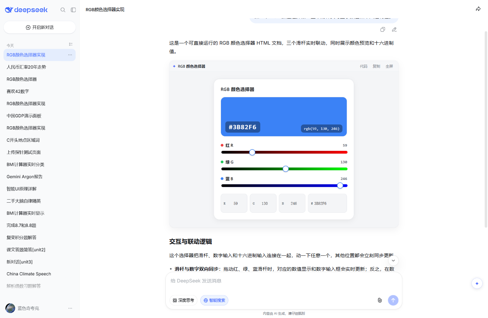

# DeepSeek Intelligent UI（油猴脚本）

给 [chat.deepseek.com](https://chat.deepseek.com/) 引入类似 GPT-6 **Intelligent UI** 的机制：

1. **每轮自动注入界面协议** —— 在发往 DeepSeek 的 `completion` / `edit_message` 请求里，把一段「智能界面协议」追加到用户 prompt 末尾。界面上的用户消息保持原样；协议只对模型可见。
2. **流式渲染可交互组件** —— 模型按协议输出 ` ```dsui ` 代码块（一份自包含 HTML 文档）后，脚本把它就地渲染成沙箱 iframe：生成过程中渐进刷新、可交互、可全屏、可切换源码。
3. **组件回传对话** —— 组件里调用 `window.dsui.sendMessage('...')` 后，卡片底部会出现「组件请求发送消息」确认栏，用户点「发送」才会写入输入框并发送（默认不自动发送，避免组件加载即发消息）。
4. **历史消息自动净化** —— 注入内容存在 DeepSeek 服务端，刷新/切换对话时脚本会在响应被应用读取前剥离注入块，界面、编辑框、复制内容都不会出现协议文本。
5. **主题 / 高度 / 安全** —— 组件跟随 DeepSeek 深浅色（`data-ds-theme` + `@media (prefers-color-scheme)` 兜底）；iframe 自适应高度（上限 72vh，内部可滚动）；`sandbox="allow-scripts"`（无 same-origin / forms / top-navigation），CSP 禁止外链、网络请求、表单提交。



## 安装

1. 安装 [Tampermonkey](https://www.tampermonkey.net/)（Edge / Chrome）。
2. 构建（或直接使用仓库里的 `dist/intelligent-deepseek.user.js`）：
   ```bash
   pnpm install && pnpm build
   ```
3. 打开 Tampermonkey 管理面板 → 实用工具 → 导入，选择 `dist/intelligent-deepseek.user.js`；或把文件拖进浏览器安装页。
4. 打开 <https://chat.deepseek.com/>，登录后右下角出现 `✦` 按钮（也可用油猴菜单「✦ Intelligent UI 设置」）。

## 使用

- 正常对话即可。遇到适合界面的问题（数据可视化、计算器、规划、表单、模拟、教学、小游戏等），模型会在简短说明后输出 `dsui` 组件，脚本自动渲染；一次回答可以包含多个组件卡片。
- 卡片工具栏：**代码**（查看源码）/ **复制** / **全屏**（Esc 退出）。
- 组件内点击会调用 `window.dsui.sendMessage(...)` 的操作时，卡片底部出现确认栏，点**发送**才会真正发一条对话消息。
- 若模型偷懒输出普通 `html` 完整文档，默认也会被渲染（设置里可关掉；注意这会把教程里的完整 HTML 也执行起来）。
- 设置项：总开关、每轮注入、自动渲染、普通 html 兜底、允许组件回传（仍需确认）、显示悬浮按钮、协议语言、附加要求。

## 组件 API（给模型生成的 HTML 用）

```js
window.dsui.sendMessage('帮我把这个结果再解释一下') // 进入父端确认栏，用户确认后发送
window.dsui.setTitle('自定义标题')                  // 更新卡片标题
window.dsui.resize()                               // 手动触发高度重测
window.dsui.theme                                  // 'light' | 'dark'
```

- 组件必须是单文件、内联 CSS/JS，不能访问网络（CSP `connect-src 'none'`、`default-src 'none'`），图片只能用 SVG / data URI / emoji。
- 组件运行在 opaque origin 的 iframe 里，**不能使用 localStorage/sessionStorage**，状态放内存。
- 主题：客户端在 `<html>` 上设置 `data-ds-theme="light|dark"`；推荐用 `:root[data-ds-theme="dark"]` 覆盖变量，也兼容只用 `@media (prefers-color-scheme: dark)` 的写法（脚本会按当前主题展开媒体查询）。
- 需要继续对话时优先用确认式回传；组件脚本不能绕过父端确认直接发消息。

## 开发

```bash
pnpm install
pnpm test          # 单元测试（Vitest + jsdom，30 项）
pnpm build         # 构建 dist/intelligent-deepseek.user.js
pnpm test:mock     # 离线 mock E2E（28 项检查，不登录、不耗额度）
pnpm login         # 打开可见 Edge 窗口手动登录一次（保存 .browser-profile / .auth）
pnpm test:e2e      # 真实账号 E2E（23 项检查，会创建测试对话）
```

### 目录

```
src/
  main.js         入口：帧判断、启动拦截/渲染/设置
  inject.js       XHR/fetch 拦截：注入 prompt、净化 history/share 响应
  prompt.js       协议文本、末尾块注入与剥离
  sanitize.js     响应/对象深度净化
  renderer.js     DOM 扫描、卡片生命周期、兜底清理
  widget.js       iframe 沙箱、bridge、确认栏、工具栏、渐进式渲染
  dom.js          DeepSeek DOM 适配（集中改版修复点）
  chat.js         受控 textarea 的程序化发送（草稿保护 / 发送箭头识别）
  settings.js     设置存取（GM_* 优先，localStorage 兜底）
  settings-ui.js  悬浮按钮 + Shadow DOM 设置面板 + toast
  theme.js        深浅色检测/监听
  styles.js       全局样式
tests/
  unit/           Vitest 单元测试
  mock/           离线 DeepSeek DOM 模拟页面
  e2e/mock.mjs    离线 mock E2E
  e2e/run.mjs     真实站点端到端测试
docs/
  ARCHITECTURE.md 请求链路、DOM 结构、沙箱、改版急救清单
scripts/
  build.mjs       esbuild 打包 + 油猴头
  login.mjs       手动登录并保存浏览器态
```

更细的请求格式、DOM 选择器与实现决策见 [docs/ARCHITECTURE.md](docs/ARCHITECTURE.md)。

### 已知限制 / 风险

- 协议依赖模型配合；不遵守时会退化为普通代码块（可用 `renderPlainHtml` 兜底渲染完整 HTML）。`renderPlainHtml` 默认开启，会把回答中的完整 HTML 当组件执行（沙箱内，禁网），不希望在教程里执行可关掉。
- `regenerate`（重新生成）请求没有 prompt 字段，无法补协议；如果该轮用户消息是安装脚本前发送的，重新生成不会带协议。
- 注入会存进 DeepSeek 服务端：**分享/导出/未安装脚本的查看者可能看到协议文本**（`share/content` 只对装了脚本的查看者生效）。介意隐私时可在设置里关掉「每轮自动注入」。
- 主题切换会重建组件 iframe，组件内部状态（输入、滚动位置）会丢失。
- 组件回传需要父端确认，属于 UX 防误触而非密码学边界；同卡片限制 1 分钟内最多 5 次。
- 组件内 `localStorage`、外部请求、表单提交、外部链接、自行导航都会被阻止；检测到导航会停用该卡片。
- DeepSeek 前端改版后选择器可能失效，改动点集中在 `src/dom.js`、`src/inject.js`、`src/chat.js`、`src/theme.js`。
- E2E 在 Edge + Playwright（页面 realm 注入）验证；Tampermonkey `@grant` 沙箱没有单独自动化验证，安装后建议先发一条「做个颜色选择器」冒烟。

## 隐私说明

- 注入只发生在本地浏览器发出的请求体中，不经过第三方服务器。
- 登录态保存在本机 `.browser-profile` / `.auth`（已 gitignore），仅用于本机测试。
- 测试账号的对话记录会出现在 DeepSeek 历史里（E2E 会创建含「RGB 颜色选择器」「BACKCHANNEL_OK」等字样的对话），可自行删除。

## License

MIT
